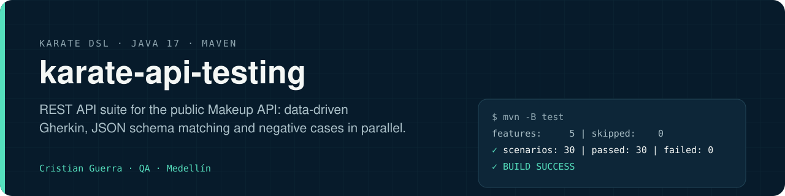
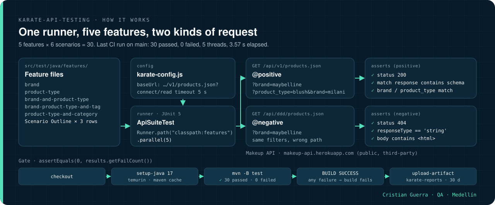
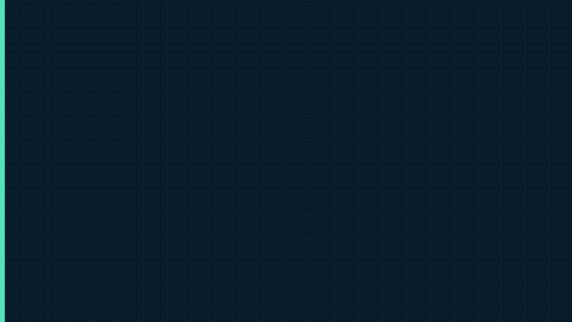

[Leer en español](README.es.md)

<p align="center">
  
</p>

## Explained like you're 8

Imagine a shop that answers questions by computer instead of by phone. You ask "show me Maybelline products" and it sends back a list. This project is like a teacher grading that answer: it checks the list has every part it should (a name, a price, a brand…) and that the brand really is Maybelline. It also knocks on a door that does not exist, on purpose, to make sure the shop says "not found".

### A real example

- **Imagine that:** we ask the Makeup API for products with `brand=maybelline`.
- **What should happen:** it answers "200, all good" with a list, and the first product's brand is Maybelline.
- **What the project does:** Karate checks the status number, compares the answer with a template (`id` must be a number, `name` must be text, …) and reads the brand.
- **What we gain:** if the shop changed the shape of its answers or sent the wrong brand, the test would fail and the whole build would stop. On CI, all 30 scenarios passed.

<p align="center">
  
</p>

The same animation as [MP4](docs/assets/explained.mp4).

### Hard words

| Word | What it means |
|---|---|
| API | A shop window for computers: a program asks, it answers with data |
| Status code | A number that says how it went: 200 means OK, 404 means not found |
| Schema | The template an answer has to follow, like the boxes on a form |
| Scenario Outline | One test written once and played with several example rows |
| Parallel | Several helpers working at the same time |
| CI | A robot that runs all the tests every time someone uploads a change |

# Karate API Testing

REST API test suite built with Karate DSL and Maven against the public [Makeup API](http://makeup-api.herokuapp.com/): data-driven scenarios, response schema matching and negative cases, executed in parallel and on CI.

[](https://github.com/criguex/karate-api-testing/actions/workflows/ci.yml)


## How it works

<p align="center">
  
</p>

1. Each feature is a `Scenario Outline` with three example rows, tagged `@positive` or `@negative`.
2. `karate-config.js` sets `baseUrl` and 5 s connect/read timeouts; `ApiSuiteTest` runs every feature with `Runner.path("classpath:features").parallel(5)`.
3. `@positive` scenarios call `GET /api/v1/products.json` with the example filters, expect `200`, match the body against `schema_response/*.json` and check the filtered field.
4. `@negative` scenarios call the same filters on a wrong path and expect `404` with an HTML body.
5. The runner asserts `results.getFailCount() == 0`, so any failed scenario fails the Maven build.

<p align="center">
  
</p>

The animation replays the real log of CI run [36095563876](https://github.com/criguex/karate-api-testing/actions/runs/36095563876) (also as [MP4](docs/assets/how-it-works.mp4)).

## What it tests

Endpoint under test: `GET /api/v1/products.json` with query-string filters.

| Feature | Filters | `@positive` scenario | `@negative` scenario |
|---|---|---|---|
| `brand.feature` | `brand` | 200, schema match, first item's brand matches | wrong path returns 404 with an HTML body |
| `product-type.feature` | `product_type` | 200, schema match, product type matches | wrong path returns 404 with an HTML body |
| `brand-and-product-type.feature` | `brand`, `product_type` | 200, schema match, brand and product type match | wrong path returns 404 with an HTML body |
| `brand-product-type-and-tag.feature` | `brand`, `product_type`, `product_tags` | 200, schema match, product type matches | wrong or empty path returns 404 with an HTML body |
| `product-type-and-category.feature` | `product_type`, `product_category` | 200, schema match, product type and category match | wrong or empty path returns 404 with an HTML body |

Every scenario is a `Scenario Outline` with three example rows: 5 features, 30 scenarios.

**Latest CI result on `main`** (run 36095563876, 2026-09-25), from the Karate summary:

```text
Karate version: 1.3.1
elapsed:   3.57 | threads:    5 | thread time: 7.38
features:     5 | skipped:    0 | efficiency: 0.41
scenarios:   30 | passed:    30 | failed: 0
[INFO] BUILD SUCCESS
```

## Architecture

- **Karate DSL**: HTTP calls, assertions and JSON matching written in Gherkin, no glue code.
- **Schema matching**: expected response shapes live in `schema_response/*.json` using Karate fuzzy markers (`#number`, `#string`, `#array`, `#present`) and are applied with `match response contains`.
- **Configuration**: `karate-config.js` defines `baseUrl` and connect/read timeouts (5 s each).
- **Runner**: a single JUnit 5 test (`runner/ApiSuiteTest`) executes all features with 5 parallel threads and fails the build on any scenario failure.

## How to run

Requires JDK 17 and Maven 3.x.

```bash
git clone https://github.com/criguex/karate-api-testing.git
cd karate-api-testing
mvn clean test

mvn test -Dkarate.options="--tags @positive"
mvn test -Dkarate.options="--tags @negative"
```

## Project structure

```
.
├── .github/workflows/ci.yml
├── docs/
│   ├── assets/        banner.svg, how-it-works.*, explained.* (kids' animation, EN + .es)
│   └── scenes/        how-it-works.html, explained.html + their export scripts
├── pom.xml
└── src/test/java/
    ├── features/
    │   ├── brand.feature
    │   ├── product-type.feature
    │   ├── brand-and-product-type.feature
    │   ├── brand-product-type-and-tag.feature
    │   └── product-type-and-category.feature
    ├── runner/ApiSuiteTest.java
    ├── schema_response/
    │   ├── responseMarcaJson200.json
    │   └── responseProductoJson200.json
    ├── karate-config.js
    └── logback-test.xml
```

## Reporting

- Karate HTML report: `target/karate-reports/karate-summary.html`, with a page per feature including request and response logs.
- Cucumber JSON in `target/karate-reports/` for downstream tooling; Surefire XML in `target/surefire-reports/`.
- On CI `target/karate-reports/` is uploaded as a build artifact.

## CI

GitHub Actions (`.github/workflows/ci.yml`) runs `mvn -B test` with Temurin JDK 17 on every push and pull request to `main`. The suite depends on the public Makeup API being available.

## Limits

- Every scenario calls the public, third-party Makeup API, so its availability and data decide the result; there is no mock.
- The negative cases cover wrong paths (404 with an HTML body); invalid filter values are not tested.

## Rebuilding the animation

`docs/scenes/how-it-works.html` draws each frame from `?t=<seconds>`; `docs/scenes/export.sh` captures the frames with headless Chrome and encodes `how-it-works.gif` and `how-it-works.mp4` with ffmpeg. `docs/scenes/explained.html` (`?t=<seconds>&lang=en|es`) and `docs/scenes/export-explained.sh` do the same for the kids' animation.

---

Cristian Guerra · Senior SDET · [linkedin.com/in/criguex](https://www.linkedin.com/in/criguex)
